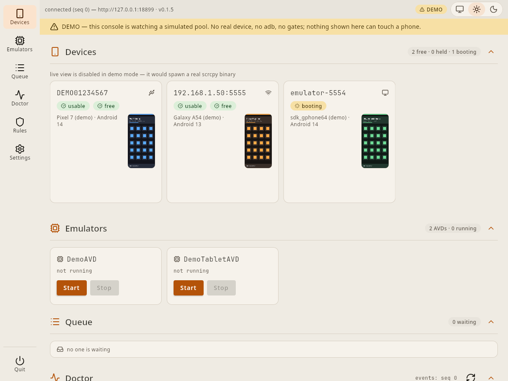

<p align="center">
  
</p>

# Corral
### Two coding agents. One phone. No collisions.

Corral pools every Android device on your machine — USB, WiFi, emulators — and leases
each one to exactly one agent session. The second agent doesn't trample the first one's
test run: it queues, or it is turned away with a message that names the holder and the
two forms that work.


[](https://glama.ai/mcp/servers/ciszkin/corral)

[Adopting Corral](CUTOVER.md) · [Security policy and threat model](SECURITY.md) ·
[Agent skill](skills/corral/SKILL.md) · Apache-2.0 ([LICENSE](LICENSE), [NOTICE](NOTICE))

## Try it without a phone

Once installed, `corral demo` starts a second, isolated daemon whose pool is simulated in process —
no adb, no SDK, no real device or home, no gates, nothing installed. It prints the URL, and the same
CLI and console point at it:

```sh
corral demo                              # 8799 unless taken; it prints the actual URL
CORRAL_URL=http://127.0.0.1:8799 corral devices
corral-ui --url http://127.0.0.1:8799
```

The console itself shows a persistent DEMO banner at the top of its window:



Ctrl-C stops it and removes the demo home it made; [CUTOVER.md § Demo](CUTOVER.md#demo) has the
flags and the cleanup rules.

## Install (Linux, JDK 17+; Windows uses the same installer)

No clone and no Gradle: the release bundle carries both jars and the installer. Check it
against the published checksum, and
[read the installer first](https://github.com/ciszkin/corral/blob/v0.1.8/scripts/install.sh)
— it is the same `scripts/install.sh` the source tree uses. You need JDK 17+ and an
Android SDK with `platform-tools/adb`. The installer stops without usable Java, and it refuses
an `adb` that is not the SDK's — one that only resolves from `PATH`, such as the distro's
`/usr/bin/adb` — before anything is written, because it has to replace the SDK's `adb` with
the lease-gating wrapper. With no adb at all it installs with a warning and the daemon lists no
devices; `corral demo` needs no adb, SDK or phone.

```sh
curl -fsSLO https://github.com/ciszkin/corral/releases/download/v0.1.8/corral-0.1.8.zip &&
curl -fsSLO https://github.com/ciszkin/corral/releases/download/v0.1.8/corral-0.1.8.zip.sha256 &&
sha256sum -c corral-0.1.8.zip.sha256 &&
unzip corral-0.1.8.zip -d corral-0.1.8 &&
(cd corral-0.1.8 && ./install.sh --ui)
```

From a source checkout instead:

```sh
git clone https://github.com/ciszkin/corral && cd corral
./gradlew :corral-daemon:shadowJar :corral-ui:shadowJar
scripts/install.sh --ui          # --no-ui skips the console
```

The installer is user-scoped (no root) and idempotent: it puts the `corral` CLI, an `adb`
wrapper and the `corral-ui` shim on `~/bin`, shims the SDK's adb, drops the Gradle gate
and the agent skill, and starts the daemon at login. On Windows the same installer writes
`corral.bat` and `adb-wrapper.bat` to `%USERPROFILE%\bin` instead, with no SDK adb shim.
`install.sh --help` lists the flags; [CUTOVER.md § Windows](CUTOVER.md#windows) has the
Windows detail.

It ends by listing what it installed and the one line this shell needs: `~/bin` has to be
ahead of the Android SDK on `PATH` (`%USERPROFILE%\bin` on Windows), or `adb` resolves to the
ungated one:

```sh
export PATH="$HOME/bin:$PATH"
```

The installer appends that line to `~/.bashrc`/`~/.zshrc` when either exists, so a new shell
already has it; a shell that is already open needs the line once. Then:

```sh
corral devices                   # live pool
corral doctor                    # per-layer health (not the Gradle gate — see CUTOVER.md)
corral lease --timeout 60 --type emulator -- ./gradlew connectedDebugAndroidTest
corral status                    # who holds what, and until when
```

## Wire an agent in

```sh
claude mcp add --transport http corral http://127.0.0.1:8798/mcp
```

Eight tools (`list_devices`, `queue`, `claim`, `free`, `renew`, `screenshot`,
`start_emulator`, `stop_emulator`), one identity per MCP session. The installer also drops
the agent skill at `~/.agents/skills/corral/SKILL.md` — creating `~/.agents/skills` when the host
has none, so a fresh machine gets it from the one command — and links `~/.claude/skills/corral` at
it for Claude Code, which reads `~/.claude/skills/` instead. Any harness can drive the CLI verbs
directly.

## Why not just `ANDROID_SERIAL`?

Because that only binds callers that cooperate, and agents don't. Corral decides at exec
time, with three layers on POSIX: an `adb` wrapper on `PATH`, an SDK
`platform-tools/adb` shim for absolute-path callers, and a Gradle `init.d` gate — AGP never
runs the adb binary, so only a build-level gate can stop an `install*` /
`connected*AndroidTest`. A Windows install has two of those layers (the `.bat` wrapper and
the Gradle gate), because the SDK's `adb.exe` is not shimmed. Leases are FIFO-queued,
TTL-bounded, pid-liveness-aware, persisted in SQLite and audited, and a denial is
self-teaching rather than a mystery. The wrapper's rules live in one editable file,
`~/.config/corral/rules`, and a missing one fails closed. Repair is automatic: while the
daemon runs it checks the SDK adb shim every 10 seconds
and restores it after an SDK update, keeping the updated binary as `adb.real`; if the
daemon was stopped at the time, it heals at the next start. Re-running the installer is
the manual fallback, not a routine step. `corral doctor` reports each layer it can
inspect; the Gradle gate is the one it cannot see.

## Status — plainly

| | |
|---|---|
| Linux | verified: four Gradle modules, five suites (module tests, wrapper, e2e, install, demo), Linux CI plus a host |
| Windows | host-verified on one box; **two gate layers, not three** ([CUTOVER.md § Windows](CUTOVER.md#windows)) |
| macOS | **no installer** — the daemon and CLI are portable Java, packaged and verified nowhere |
| Gate | exec time: a client that bypasses the wrapper, the SDK shim and Gradle is outside it |
| Identity | cooperative, not authentication: a local process can claim to be anyone |
| Reviews | 52 independent review passes, all findings closed; the count at the first release, with later gates recorded in corral-docs |
| Console | Compose Desktop, verified on JDK 17 (Linux) and JDK 25 (Windows, [§ Windows](CUTOVER.md#windows)); other very new JDKs untested |
| Loopback | the daemon binds `127.0.0.1` and refuses a non-local `Host` header |
| License | Apache-2.0 |

**Versions.** The tag is the only source: a release jar reports the tag it was built from
(`0.1.8`), a source build reports `git describe --tags --match v*` — that tag, or
`<tag>-<n>-g<sha>` past it — and only a tree with neither a reachable `v*` tag nor
`CORRAL_VERSION` (a jar built outside git, or a tagless clone) reports `0.0.0-dev`, which
the console shows as-is.

## Where the detail lives

- [CUTOVER.md](CUTOVER.md) — install, the claim/lease/wait loop, selectors, Gradle
  builds, emulators, the console, configuration, `doctor`, updates and uninstall.
- [Known limits](CUTOVER.md#known-limits) — the absolute-path adb exception, cooperative
  identity, loopback, Linux-only service paths.
- [Behaviour reference](CUTOVER.md#behaviour-reference) — the gates and their rules, the
  pool, the HTTP/WS/MCP surface, the config API and self-healing.
- [Repository shape and build](CUTOVER.md#repository-shape-and-build) — the four modules,
  the build, the five test suites.
- [Updates](CUTOVER.md#updates) — the daily check, the kill switch, and what an apply does
  to a running daemon or console.
- [SECURITY.md](SECURITY.md) — the trust boundary, including what the release checksum
  does and does not prove.
